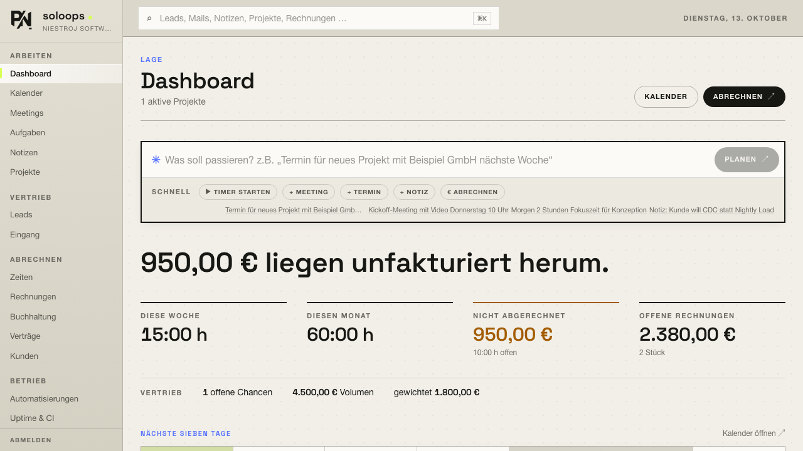
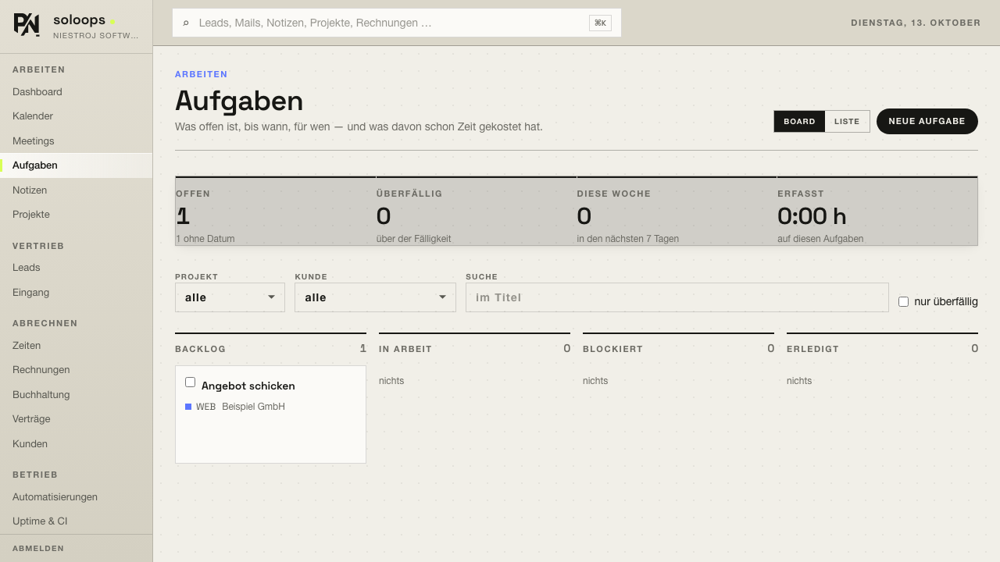
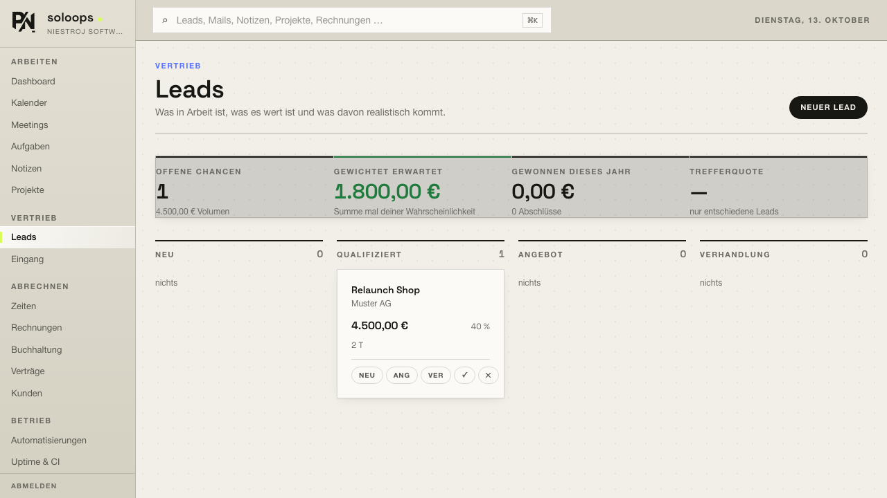
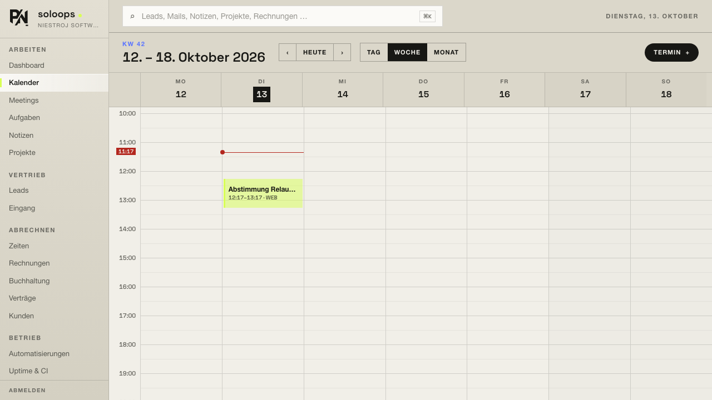
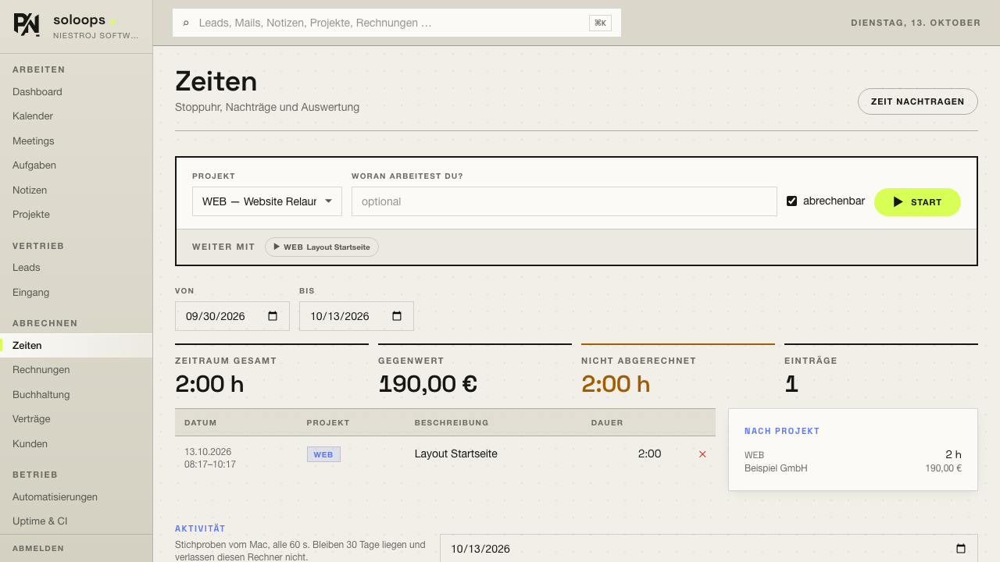

<h1 align="center">soloops</h1>

<p align="center">
  <strong>A self-hosted operating system for working solo.</strong><br>
  Calendar, meetings, notes, projects, leads, inbox, time tracking, invoices —<br>
  in one place, on your own machine, with MCP access for Claude.
</p>

<p align="center">
  
  
  
  
  
  
  
  
  
</p>



## What this is

soloops is the back office of a one-person software business, built as a single
self-hosted application. It replaces the usual pile of SaaS subscriptions —
calendar, CRM, time tracker, invoicing — with one Docker Compose stack that runs
on a laptop or a small VPS and keeps its data in a database you control.

It is published as-is, because it may be useful to someone with the same
problem. A few things are worth knowing before you invest an evening in it:

- **Single user by design.** One owner account, no tenancy boundary anywhere.
- **The interface is German.** Code, comments and the docs are English.
- **It assumes German invoicing rules** (sequential numbering per year,
  §19 UStG small-business note, lexoffice as the accounting target).
- **Schema changes go out as migrations.** `prisma migrate deploy` runs once
  before the API starts; the first migration is the schema as it stood when
  they were introduced, so an older database needs one `migrate resolve` —
  see [Operations](docs/operations.md).
- **AI is optional.** Everything except digests, lead scores, meeting
  summaries and the quick-entry parser works without an `ANTHROPIC_API_KEY`.

What it is not: a product, a hosted service, or something with a support
promise.

## Quick start

**Requirements:** Docker with Compose v2. Node 22 only if you want to run the
linter, the tests or the MCP server outside the containers.

```bash
cp .env.example .env                                     # set the secrets below
docker compose up -d --build
docker compose exec api npm -w @soloops/api run seed     # owner account + examples
```

At minimum set `POSTGRES_PASSWORD`, `DATABASE_URL` (same password),
`JWT_SECRET`, `SERVICE_TOKEN` and `OWNER_PASSWORD` — generate secrets with
`openssl rand -hex 32`. Then log in at http://localhost:5174 with
`OWNER_EMAIL` / `OWNER_PASSWORD`; the guided tour starts on first login.

| Service  | URL                        |
| -------- | -------------------------- |
| Frontend | http://localhost:5174      |
| API      | http://localhost:3000      |
| n8n      | http://localhost:5174/n8n/ |
| Postgres | localhost:5433             |

n8n is reachable on http://localhost:5678 too, but the interface uses the
proxied path — that is what lets the editor sit in an iframe. If you intend to
use the soloops nodes, build them once first (`npm run nodes:build`, or
`npm run up`, which does it for you).

## What it does

|                                                                                  |                                                                                      |
| -------------------------------------------------------------------------------- | ------------------------------------------------------------------------------------ |
|                                              |                                                  |
| **Tasks** — the same list as a board, filtered on a copy so switching is instant | **Leads** — the pipeline, weighted, with what has gone quiet                         |
|                                        |                                                    |
| **Calendar** — two-way with Google and Apple, conflicts resolved per field       | **Time** — the stopwatch where the entries are, and what the Mac picked up by itself |

Dashboard with quick entry and a setup checklist that reads real state,
calendar with free slots and an ICS feed, video rooms, meetings with AI
summaries, tasks as list and board, leads with offers and follow-ups, notes
with full-text search, project digests, uptime and CI/CD mirrors, time
tracking, invoices as PDF, lexoffice, contracts via n8n — all of it in detail
under [Modules](docs/modules.md).

## Documentation

| Document                                 | What's in it                                         |
| ---------------------------------------- | ---------------------------------------------------- |
| [Modules](docs/modules.md)               | what the thing actually does, module by module       |
| [Architecture](docs/architecture.md)     | five apps, one monorepo                              |
| [Calendar sync](docs/calendar-sync.md)   | Google, CalDAV, conflict rules                       |
| [Device sync](docs/device-sync.md)       | iPhone and Mac, an op log and no server in between   |
| [CarPlay](docs/carplay.md)               | the day in the car, and the entitlement it needs     |
| [Inbox](docs/inbox.md)                   | IMAP, rules before AI, follow-ups                    |
| [Activity](docs/activity.md)             | samples from the Mac, all local                      |
| [Automations](docs/automations.md)       | n8n embedded, with connectors both ways              |
| [MCP server](docs/mcp.md)                | 77 tools for Claude                                  |
| [macOS app](docs/macos-app.md)           | Tauri window, tray, container startup                |
| [Design system](docs/design.md)          | tokens, rules, classes                               |
| [Development](docs/development.md)       | Prettier, ESLint, tests, E2E, held-back dependencies |
| [Authentication](docs/authentication.md) | JWT, service token, automation tokens                |
| [Operations](docs/operations.md)         | logs, schema changes, backup, troubleshooting        |
| [Deployment](docs/deployment.md)         | 2 cores, 2 GB RAM                                    |
| [Security](docs/security.md)             | what to watch in production                          |

## Development

```bash
npm run check      # format, lint, types and tests in one run
npm run up         # build the n8n nodes, then bring the stack up
npm run app        # the macOS app in development mode
npm run e2e        # the interface in Chromium, Firefox and WebKit
npm run shots      # refresh docs/screenshots/ from the E2E mock
npm run ports      # who is listening on what right now?
```

Details in [Development](docs/development.md).

## Contributing

This is a personal tool that happens to be public. It is maintained for exactly
one user's workflow, and that shapes what can be accepted:

- **Bug reports are welcome**, especially with the log output and the steps to
  reproduce.
- **Pull requests are welcome** for bugs, documentation and portability. For
  features, open an issue first — the answer may well be "that's out of scope",
  and it's better to hear that before writing the code.
- **Feature requests that add a second user, a tenancy model or a hosted mode
  will be declined.** That is a different product.
- Fork it. The license allows it, the stack is ordinary, and a fork that goes
  its own way is a better outcome than a compromise nobody wanted.

Before opening a pull request, run `npm run check` (and
`npm -w @soloops/desktop run test` if you touched the macOS app). Keep the
existing conventions: German UI copy, English code and comments, Conventional
Commits.

Found a vulnerability? Please report it privately through GitHub's security
advisories rather than opening a public issue.

## License

[MIT](LICENSE) — Philipp Niestroj.
